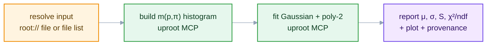
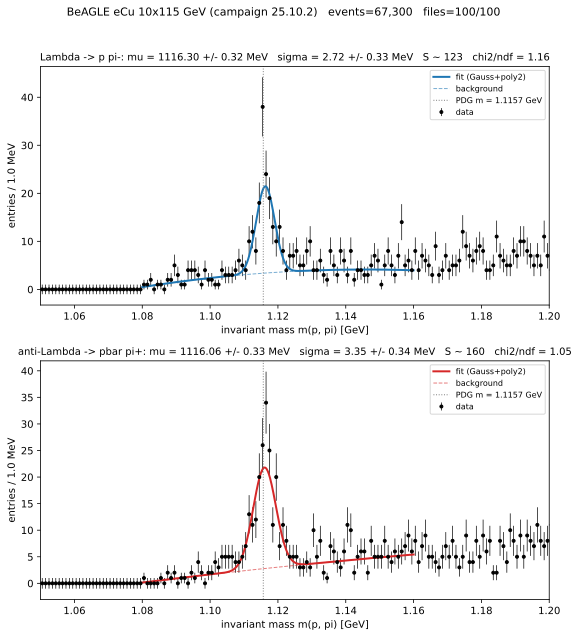

<style>
/* Mermaid: force diagram label text dark so it stays readable on the
   light node fills in BOTH light and dark mode. The Carpentries dark
   theme sets `p`/`li` color and darkens `pre` backgrounds, which would
   otherwise turn mermaid's label text light (invisible on light nodes)
   and the diagram surface dark. We override both, with !important to
   beat the theme rules and mermaid's own inline styles. */
.mermaid { background: transparent !important; }
/* Hide the Workbench "Diagram source code" spoiler under each diagram */
.mermaid-img-wrapper details { display: none !important; }
.mermaid .nodeLabel, .mermaid .edgeLabel, .mermaid .label,
.mermaid .cluster-label, .mermaid text, .mermaid tspan,
.mermaid span, .mermaid p, .mermaid foreignObject div {
  color: #10204a !important;
  fill: #10204a !important;
}
.mermaid .edgeLabel, .mermaid .edgeLabel p, .mermaid .edgeLabel rect {
  background-color: #e2e8f0 !important;
}
/* AI prompts: paste-into-your-assistant blocks. Styled like a normal
   code block (same neutral pre background/border as python etc.), with
   just a small "AI Prompt" tag in the corner. */
pre.ai-prompt, div.sourceCode.ai-prompt {
  border-top: 10px solid #7c3aed;
}
pre.ai-prompt, pre.ai-prompt code {
  white-space: pre-wrap;       /* wrap long prompts onto many lines */
  overflow-wrap: anywhere;
}
pre.ai-prompt::before, div.sourceCode.ai-prompt::before {
  content: "AI Prompt";
  display: block;
  margin-bottom: .5rem;
  font-weight: 600;
  font-size: .78em;
  letter-spacing: .03em;
  text-transform: uppercase;
  color: #7c3aed;
}
</style>

::::::::::::::::::::::::::::::::::::::::::::: questions

- How do the assistant, the servers, and the skill work together?
- How does the analysis run over many files?
- How is the yield extracted and recorded?

:::::::::::::::::::::::::::::::::::::::::::::

::::::::::::::::::::::::::::::::::::::::::::: objectives

- Set up an MCP client for the analysis.
- Scale the analysis from one file to a full dataset.
- Accept or reject an agent-produced yield using the audit checklist.

:::::::::::::::::::::::::::::::::::::::::::::

## Run it in your client

In eic-shell, in your analysis directory:

```bash
eic-mcp up
eic-mcp config opencode
R=https://raw.githubusercontent.com/eic/tutorial-mcp/main/files/skills
curl -fsSLO $R/AGENTS.md
curl -fsSL --create-dirs -o .opencode/skills/lambda-fit/SKILL.md $R/lambda-fit/SKILL.md
opencode
```

Check that `/mcp` lists `uproot`, `xrootd`, and `rucio`, then paste the prompts below. For Claude
Code, use `eic-mcp config claude` and `.claude/skills/`.

## The pipeline

The skill (Episode 4) lists the steps, the uproot server (Episode 3) reads the data, and the agent loop (Episode 1) runs and checks them.



## One file

Give the assistant one `root://` file from the dataset you found in Episode 3:

```{.ai-prompt}
Using the lambda-fit skill, measure the Lambda0 peak in this file:
root://epicxrd1.sdcc.bnl.gov:1095//... (one root:// file of the campaign 26.04.1
BeAGLE eCu ep 10x115 dataset from Episode 3's exercise).
Build the proton-pion invariant-mass histogram with the uproot MCP server (tree 'events'),
fit it, and report mu, sigma, the yield, and chi2/ndf, with the plot, or report insufficient
statistics if the fit window is too sparse.
```

The assistant builds the histogram with the uproot server, then fits it. If the model stops after the histogram (smaller models often do), send the fit as a separate request:

```{.ai-prompt}
Fit the histogram you just built with execute_kernel: a Gaussian plus a 2nd-order polynomial
over [1.08, 1.16] GeV. Report mu, sigma, the signal yield S, and chi2/ndf, checked against
the lambda-fit skill's success criteria.
```

One file gives only ~8 candidates in the fit window, so the correct answer is *insufficient statistics*: the skill says to stop instead of fitting, and a model that quotes $\mu$ anyway has ignored it. The peak at $\mu \approx 1.1157$ GeV comes from the larger sample below.

::::::::::::::::::::::::::::::::::::::::::::: callout

## Different tool choices

A smaller model may call different tools than the skill specifies and still produce the same histogram. The audit checklist below checks the result, not which tools were used.

:::::::::::::::::::::::::::::::::::::::::::::

## Scaling to the full sample

The same calculation can run over many files and return one merged histogram:

```{.ai-prompt}
Using the lambda-fit skill, run the same proton-pion mass kernel across the first 8 files of the
campaign 26.04.1 BeAGLE eCu ep 10x115 dataset with execute_kernel_dataset (tree 'events'),
merge the histograms, then fit the result and report mu, sigma, the yield, and chi2/ndf
for both Lambda and anti-Lambda, with the plot.
```

Eight files take about a minute (paste the fit prompt above if it stops). For more files, run background jobs in **batches of ~20 files** and let the assistant wait for them:

```{.ai-prompt}
Using the lambda-fit skill, run the proton-pion mass kernel over the first 100 files of the
campaign 26.04.1 BeAGLE eCu ep 10x115 dataset. Submit it with submit_kernel_dataset
(tree 'events') in batches of about 20 files, poll get_job_status until every job finishes,
fetch the histograms with get_job_result and merge them, then fit and report mu, sigma,
the yield, and chi2/ndf for both Lambda and anti-Lambda, with the plot.
```

With ~100 files the Λ⁰ and Λ̄ peaks are visible above the combinatorial background:

{alt='Proton–pion invariant-mass spectrum with Gaussian-plus-polynomial fits showing clear Lambda and anti-Lambda peaks near 1.1157 GeV'}

```output
Lambda      -> p pi-:   mu = 1116.30 +/- 0.32 MeV   sigma = 2.72 +/- 0.33 MeV   S = 123   chi2/ndf = 1.16
anti-Lambda -> pbar pi+: mu = 1116.06 +/- 0.33 MeV   sigma = 3.35 +/- 0.34 MeV   S = 160   chi2/ndf = 1.05
```

The fitted $\mu$ sits ~0.6 MeV above the PDG value (1.115683 GeV), a calibration-level offset typical of reconstructed momenta; $\sigma$ is the detector mass resolution, not the (negligible) Λ⁰ natural width.

## Extracting the yield

The fit model is a Gaussian signal on a second-order polynomial background over $[1.08, 1.16]$ GeV:

$$
f(m) = A \exp\!\left[ -\tfrac{1}{2} (m - \mu)^2 / \sigma^2 \right] + \left( c_0 + c_1 (m - m_\Lambda) + c_2 (m - m_\Lambda)^2 \right)
$$

The polynomial describes the combinatorial background (Episode 2); the integrated signal is $S = A\sqrt{2\pi}\,\sigma / (\text{bin width})$. Report $S$ with its uncertainty alongside $\mu$, $\sigma$, and $\chi^2/\text{ndf}$; a bare bin count mixes signal with background.

::::::::::::::::::::::::::::::::::::::::::::: callout

## Audit checklist

* **Signal.** $\mu$ within a few MeV of 1.115683 GeV; $\sigma$ consistent with detector resolution; $\chi^2/\text{ndf}$ of order unity; $S$ reported with an uncertainty.
* **Inputs pinned.** Dataset (campaign and file list), particle masses, mass window, binning, and fit range all fixed and recorded.
* **Provenance.** Tool calls and their arguments logged, so the run can be reconstructed.
* **Cost limited.** Tested on a few files before scaling up.
* **Human check.** Someone looked at the fit before the result was reported.

:::::::::::::::::::::::::::::::::::::::::::::

## Exercises

* Run the single-file chain through your assistant and report $\mu$, $\sigma$, $S$, and $\chi^2/\text{ndf}$.
* Process 8 files and compare the fit to the ~100-file result; comment on the statistical uncertainty.
* Complete the audit checklist for your run, attaching the recorded tool calls as provenance.

::::::::::::::::::::::::::::::::::::::::::::: callout

## Try a different beam

The same prompt works with any reconstructed-DIS DID. Nuclear beams (eCu, eAu) give the most Λ per
event; ep samples need a few times more files.

:::::::::::::::::::::::::::::::::::::::::::::

The [final episode](06-eic-mcp-servers.md) lists the other MCP servers the EIC provides.

::::::::::::::::::::::::::::::::::::::::::::: keypoints

- With the lambda-fit skill, the same prompt runs the analysis on one file or on many.
- Check the fit against the audit checklist before you trust it.

:::::::::::::::::::::::::::::::::::::::::::::
